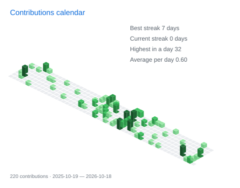
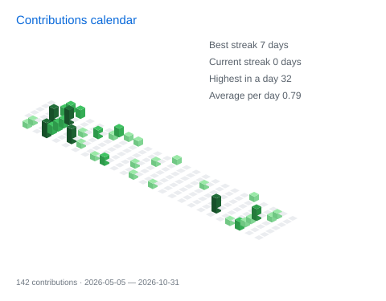
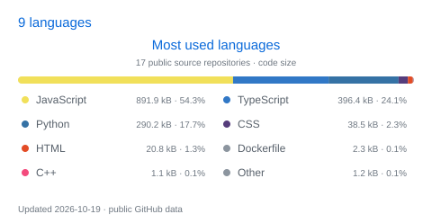
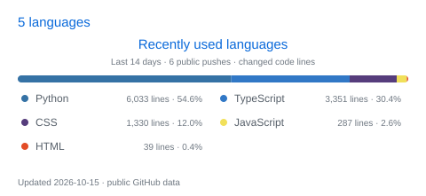

  

  My name is <strong>Trần Trung Nguyên</strong> 
  My role is full-stack developer  
  I luv building, learning, and sharing through code.

<table>
  <thead>
    <tr>
      <th width="50%">Isometric commit calendar</th>
      <th width="50%">Languages activity</th>
    </tr>
  </thead>
  <tbody>
    <tr>
      <td valign="top">
        

          
Full year calendar

           
          
        

         
        

          
Half year calendar

           
          
        

      </td>
      <td valign="top">
        

          
Most used · public repositories

           
          
        

         
        

          
Recently used · last 14 days

           
          
        

      </td>
    </tr>
  </tbody>
</table>

  Have a project in mind, or just want to say hi? Let's connect!

  
  
  

